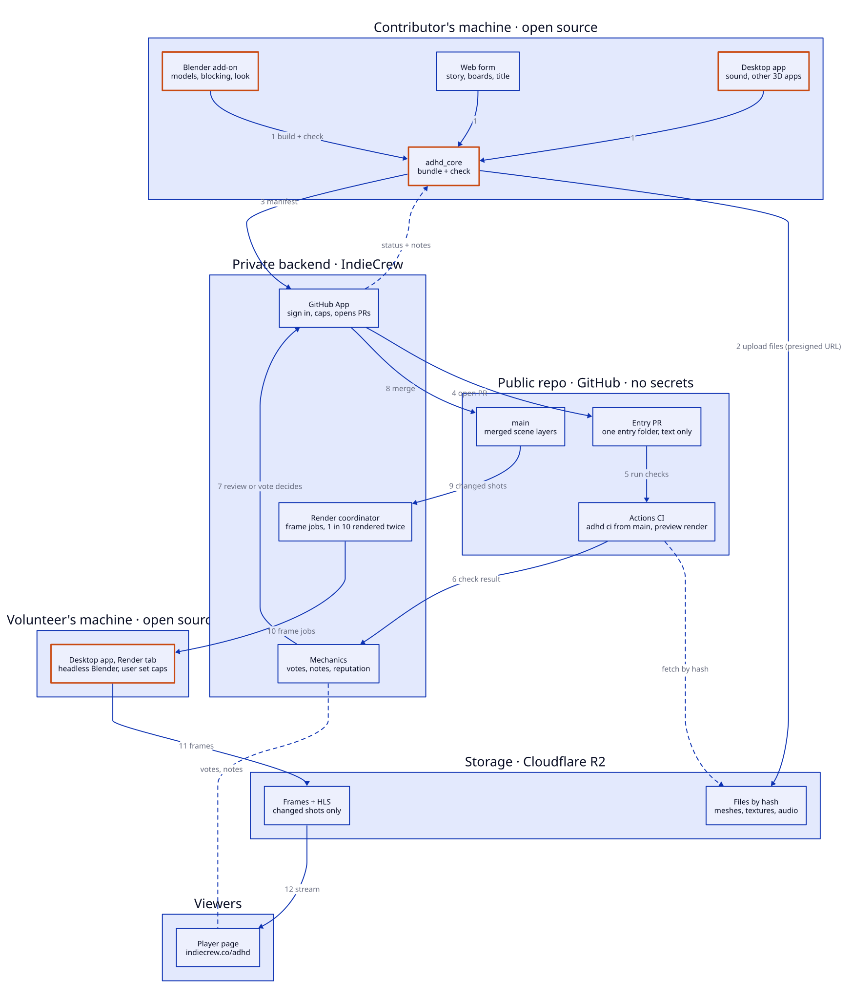

# How a piece of work gets into the film

Source: [pipeline.d2](pipeline.d2). After editing it, run `./docs/render.sh`
(needs [D2](https://d2lang.com)) and commit both files.

Orange outlines are built in this repo. Dashed lines are feedback or reads,
not part of the main path.

1. **Make and check.** The contributor works in Blender, the web form or
   the desktop app. `adhd_core` builds the bundle and runs every check it
   can.
2. **Upload files.** The App hands out presigned URLs. Files go to R2 once,
   by hash. Heavy files never enter Git.
3. **Send the manifest** to the GitHub App.
4. **Open a PR** in the film repo with the manifest and any text files.
5. **CI rechecks** with `adhd_core` and the slot from `main`, fetching files by hash, and
   makes a preview render.
6. **Check result** goes to the mechanics.
7. **Decide.** Claim slots go to reviewers, open calls to a vote.
8. **Merge.** The App merges the PR into `main`.
9. **Changed shots** go to the render coordinator.
10. **Frame jobs** go to volunteers. One frame in ten goes to two machines.
11. **Frames** upload to R2.
12. **Stream.** Changed shots are cut into HLS and the player shows the new
    cut.

Only the private backend holds tokens. The public repo holds no secrets.
