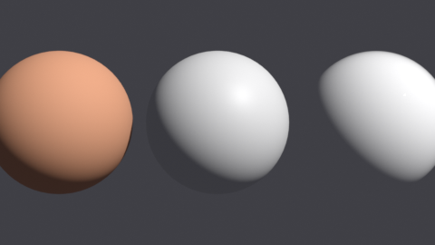
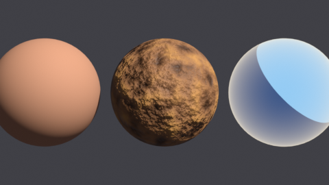
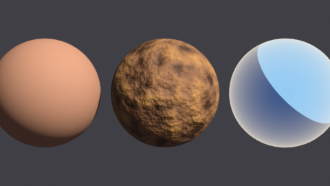
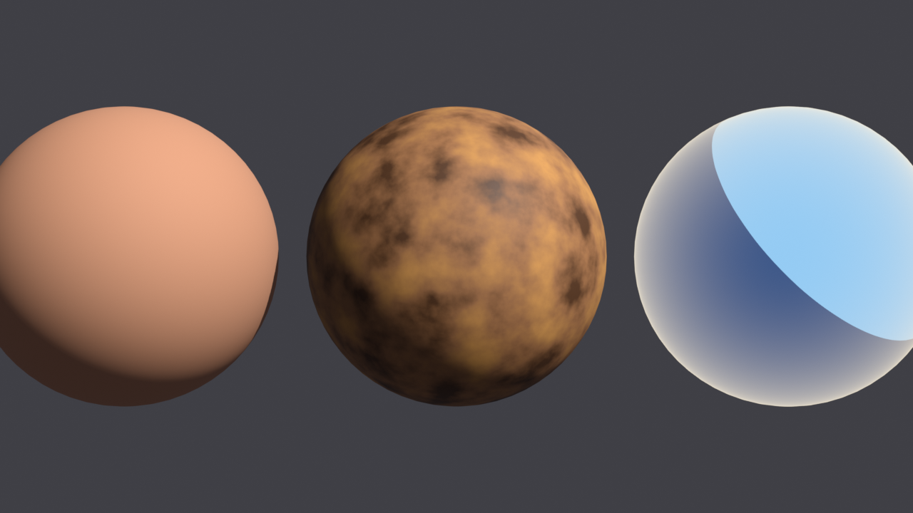

# Spikes

Short experiments that settle a design question before real code depends
on it. Each one runs headless in Blender and writes `results.json`.

```
blender -b --factory-startup -P spikes/<name>/spike_<name>.py -- <out dir>
```

Run on Blender 5.2.3 LTS (Python 3.13, OpenUSD 26.03 bundled), 13 Nov 2026.

## A. Materials: USD loses them, recipes keep them exactly

Three materials of rising difficulty, rendered in Eevee, sent through three
paths and rendered again. Eevee is deterministic here: the same scene
rendered twice differs by exactly 0.

| Path | Mean pixel error (0 to 255) | Clay | Rust | Toon | Pixels off by more than 8 |
|---|---|---|---|---|---|
| JSON recipe | **0.0** | 0.0 | 0.0 | 0.0 | 0% |
| USD, UsdPreviewSurface | 18.3 | 0.0 | 32.8 | 22.2 | 30% |
| USD, MaterialX | 18.3 | 0.0 | 32.8 | 22.2 | 30% |




Top: original. Bottom: after USD. Only the plain Principled material
survives. Through USD, every node graph collapses to a bare Principled
BSDF, so the rust and the toon sphere come back white. Blender writes
MaterialX on export but its importer ignores it, so MaterialX changes
nothing for a round trip.

The recipe is a JSON list of nodes (type, values, ramp stops) and links.
Three materials take 11 KB. Rebuilt node by node, the render is pixel
identical. It holds no code, so it is safe to accept from strangers, and
its node types are easy to check against an allowlist.

**Decision:** materials travel as recipes. USD carries geometry only.

## B. Animation: USD keeps it, including onto a library rig

A skinned three bone rig (3,744 vertices), animated over 48 frames with up
to 1.34 m of motion. Every vertex is compared on every frame.

| Path | Max error | Pass (0.1 mm) |
|---|---|---|
| USD round trip: mesh, skeleton and animation | 0.0011 mm | yes |
| Animation from USD onto a fresh copy of the rig | 0.0011 mm | yes |

The second row is the real case: contributors animate a library rig, only
the animation travels, and it is applied to the film's own copy of the rig.

What it took:

- USD brings rotations back as **quaternions**. A pose bone only reads the
  curves that match its rotation mode, so the receiving rig must be set to
  quaternion first. Without that the rig does not move at all.
- Bone names and the rest pose must match the library rig exactly. The
  add-on should check both before export.
- Blender samples every frame on export (48 keys per curve), so the
  original keyframe spacing is not kept. The motion is.

**Decision:** animation travels as USD skeletal animation on a library rig.

## E. Older Blender versions: 4.5 and newer come through identical

A prop (subdivided monkey, 2,012 vertices, UVs), the three materials from
spike A as recipes, and the skinned animation from spike B were exported
from each Blender with [versions/spike_versions.py](versions/spike_versions.py),
then checked and rendered on the pinned 5.2.4. Run on macOS arm64,
20 Nov 2026. Raw results in [versions/results/](versions/results/).

| Made in | Prop | Materials vs native 5.2 (0 to 255) | Animation round trip | Animation on library rig | `pxr` |
|---|---|---|---|---|---|
| 4.2.23 LTS | identical | **rust off by 4.9** | 0.001 mm | 0.001 mm | 0.24.5 |
| 4.5.16 LTS | identical | 0.0 | 0.001 mm | 0.001 mm | 0.25.2 |
| 5.1.2 | identical | 0.0 | 0.0011 mm | 0.0011 mm | 0.25.8 |
| 5.2.4 LTS | identical | 0.0 | 0.0011 mm | 0.0011 mm | 0.26.3 |

Every recipe rebuilt with no dropped nodes, values or links. The rust
material differs because the Bump node changed after 4.2: its default
Distance went from 1.0 to 0.001 and a Filter Width input was added. The
recipe faithfully carries 4.2's value, but the node no longer behaves the
same, so the rebuild is 2.7 from what the artist saw in 4.2, against 0.5
for materials without a bump (that 0.5 is Eevee itself changing between
4.2 and 5.2). Between 4.5 and 5.2, Eevee renders the same scene within
0.02.





Top: as the artist saw it in 4.2. Bottom: the same recipe rebuilt in 5.2.

**Decision:** the add-on supports Blender 4.5 and newer. It also means one
animation code path, since 4.5 already has slotted actions.

## F. Eevee previews on a free runner: yes, about 9 s a frame

A free GitHub Actions runner (`ubuntu-latest`, no GPU) rendered the spike A
scene at 1280 x 720 with the pinned Blender 5.2.4, five ways. Workflow:
[.github/workflows/spike-previews.yml](../.github/workflows/spike-previews.yml),
run 20 Nov 2026.

| Try | Render | Incl. Blender start |
|---|---|---|
| Eevee, OpenGL under a virtual display (`xvfb-run`) | **8.9 s** | 10.1 s |
| Eevee, Vulkan on lavapipe | 16.8 s | 17.6 s |
| Eevee, headless software OpenGL | 20.7 s | 23.0 s |
| Cycles CPU, 16 samples | 12.6 s | 13.3 s |
| Workbench | 1.1 s | 1.8 s |

All three Eevee renders are identical to each other and within 0.04 (0 to
255) of an Eevee render on a Mac GPU, so software rendering changes the
speed, not the look.



**Decision:** previews render in Eevee under `xvfb-run` on free runners. A
turntable plus an in shot frame is a few frames, well under a minute.

## Follow ups

- Export animation without the mesh. The test file is 900 KB because it
  carries the whole skinned mesh; the add-on should send only the skeleton
  animation.
- Lights and cameras: same question as materials, not tested yet.
